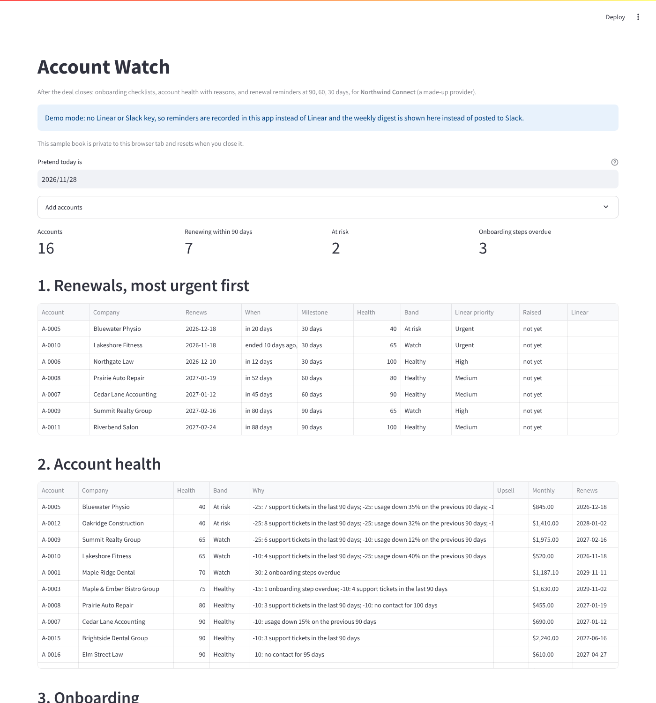

# Account Watch (onboarding and renewal)

**Problem:** after the deal closes, nobody checks that the install, number porting and training happened, and renewals get noticed too late, when the client is already talking to someone else.

**What it does:**
1. Gives every new account an **onboarding checklist** with due dates, built from the services it bought (no porting step if it has no phone lines).
2. Scores **account health** from 0 to 100 from overdue onboarding, support tickets, usage changes and time since the last contact, and shows the reason for every point lost. Usage growth is flagged as an **upsell signal**.
3. A daily Kubernetes CronJob raises a **Linear issue** for each overdue onboarding step, and one renewal issue per account when it is 90 days from renewal. At 60 and 30 days the same issue is escalated (new title, higher priority, a comment with the latest health) instead of a new issue each time. Renewals are ranked by how close they are, then by how weak the account is.
4. A weekly CronJob posts a **digest to Slack**: renewals, at-risk accounts, overdue onboarding and upsell signals.
5. Ticking off an onboarding step in the app closes its Linear issue.

All companies, people and numbers are **made up**. The provider is Northwind Connect, a fictional company. Three accounts carry on from the other tools: Maple Ridge Dental (Quote Desk's sample call), and Maple & Ember Bistro Group and Corner Lantern Cafe (Lead Radar's demo leads).

Without keys it runs in **demo mode**: reminders are recorded in the app instead of Linear, and the digest is shown on screen instead of posted to Slack. It does not use Claude: every score is a fixed rule you can check by hand.



## The rules

| Rule | Value |
| --- | --- |
| Onboarding steps (days after close) | Welcome call 2, Activate mobile lines 7 (if mobile), Install internet 10 (if internet), Port phone numbers 14 (if phone), Staff training 21, 30-day check-in 30 |
| Who gets a checklist | Accounts that closed within the last 90 days |
| Overdue | Not done and past its due date (due today is not overdue yet) |
| Health start | 100, never below 0 |
| Overdue onboarding | -15 per step, at most -45 |
| Support tickets, last 90 days | 3 to 5: -10; 6 or more: -25 |
| Usage change, last 90 days vs the 90 before | Down 10 to 29%: -10; down 30% or more: -25 |
| No contact | More than 90 days since the last contact: -10 (blank means unknown: no change) |
| Bands | 75 and up Healthy, 50 to 74 Watch, below 50 At risk |
| Upsell signal | Usage up 20% or more |
| Renewal milestones | 90, 60 and 30 days before the contract ends. An ended contract (rolling month to month) counts as 30 |
| Renewal issue | Raised once at the first milestone reached, then escalated at each closer one |
| Linear priority for renewals | At risk Urgent, Watch High, Healthy Medium; one step more urgent at 30 days |
| Renewal order | Closest milestone first, then lowest health, then fewest days left |
| Overdue step issue | Priority High, due on the step's due date, closed when the step is ticked off |
| Digest | Mondays at 13:00 UTC, at most 10 lines per section |

The rules live in [`account_watch/rules.py`](account_watch/rules.py), and [`tests/test_rules.py`](tests/test_rules.py) checks every row above with exact values.

## Run it

On your laptop:

```bash
cd services/account-watch
pip install -r requirements-dev.txt
python -m pytest -q tests
streamlit run account_watch/app.py
```

Where accounts are saved: in the cluster, the chart's Postgres (tables start with `aw_`), so the app and both CronJobs share the same book. With `DATABASE_URL` or `ACCOUNT_WATCH_DATA` set, that database (or a SQLite file in that folder). With none of these, as on the public demo, each browser tab gets its own private book, loaded with the sample accounts.

Each account gets its code (A-0001, A-0002, ...) from the database when it is saved. Importing the same company and contact email twice skips the repeat.

### Your own accounts

Import a CSV in the app (there is a template to download) or from the command line. Required columns: `company`, `contact_email`, `closed_on`, `contract_end` (dates as YYYY-MM-DD). Optional: `contact_name`, `industry`, `monthly_value`, `internet`, `phone`, `mobile` (yes or no), `tickets_90d`, `usage_change_pct`, `last_contact_on`. If any row has a problem, nothing is imported and every problem is listed by row.

### Command line

```bash
python -m account_watch.cli seed                           # load the sample book into an empty database
python -m account_watch.cli import accounts.csv
python -m account_watch.cli run-daily --dry-run            # show what would be raised; writes and sends nothing
python -m account_watch.cli run-daily                      # what the daily CronJob runs
python -m account_watch.cli run-daily --today 2027-01-15   # pretend it's a later date
python -m account_watch.cli digest --dry-run               # print the digest instead of posting it
```

## On the local Kubernetes cluster (Windows, PowerShell)

From the repo root, with the kind cluster `kubernetes-lab` running:

```powershell
docker build -t smb-deal-bot/account-watch:dev services/account-watch
kind load docker-image smb-deal-bot/account-watch:dev --name kubernetes-lab
helm upgrade --install smb-deal-bot deploy/helm/smb-deal-bot -n smb-deal-bot `
  --set leadRadar.enabled=true --set quoteDesk.enabled=true --set accountWatch.enabled=true `
  --set quoteDesk.linearTeamKey=THE --set accountWatch.linearTeamKey=THE
kubectl -n smb-deal-bot rollout restart deployment/account-watch
kubectl -n smb-deal-bot port-forward svc/account-watch 8503:80
```

Then open http://localhost:8503 and press **Load the sample book**. The restart is needed on later rebuilds because the image tag stays `:dev`. To run the jobs now instead of waiting for the schedule:

```powershell
kubectl -n smb-deal-bot create job --from=cronjob/account-watch-daily daily-now
kubectl -n smb-deal-bot logs job/daily-now
kubectl -n smb-deal-bot create job --from=cronjob/account-watch-digest digest-now
kubectl -n smb-deal-bot logs job/digest-now
```

Delete a finished job with `kubectl -n smb-deal-bot delete job daily-now` before reusing its name.

### Public demo link (Streamlit Community Cloud)

Same as the other two: create a third app from this repo with main file `services/account-watch/streamlit_app.py`, Python 3.12, and **no** secrets.

## Turn on Linear and Slack

Uses the same `.env` keys as the other tools: `LINEAR_API_KEY` and `LINEAR_TEAM_KEY`, with the same team rule (blank means the first team; a team key or name matches in any case). In the cluster, `LINEAR_TEAM_KEY` comes from the Secret unless you set `accountWatch.linearTeamKey`.

For the digest, add `SLACK_WEBHOOK_URL` to `.env`: in Slack, create an app, turn on **Incoming Webhooks**, add one for the channel you want and copy its `https://hooks.slack.com/...` URL. Then recreate the Secret so the cluster sees it:

```powershell
kubectl -n smb-deal-bot delete secret smb-deal-bot-secrets
kubectl -n smb-deal-bot create secret generic smb-deal-bot-secrets --from-env-file=.env
kubectl -n smb-deal-bot rollout restart deployment/account-watch
```

## Honest limits

- Tickets, usage and last contact are numbers in the account record. A real version would pull them from the help desk, usage reports and the CRM every night.
- New accounts come from a CSV, not straight from Quote Desk. Quote Desk knows when a client replied, not when they signed, so a "won" step would have to come first.
- Onboarding steps flagged while Linear was off stay in the app; only new ones go to Linear once a key is added. Renewals do move to Linear at their next milestone.
- The health weights are a reasonable starting point, not tuned on real churn data.
