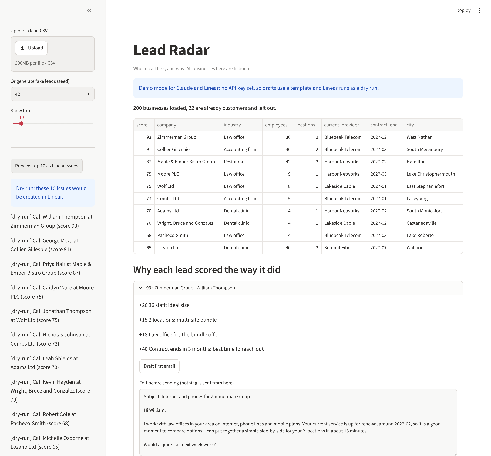

# Lead Radar (prospecting)

**Problem:** reps waste hours deciding which small businesses in a territory to call first, then write the same cold email over and over.

**What it does now:**
1. Generates 200 fictional small businesses (or takes your own CSV).
2. Scores each one out of 100 on **fit** (staff size, number of locations, industry) and **timing** (when their current contract ends).
3. Shows every score's reasons, so a rep can trust or challenge the ranking.
4. Leaves out businesses that are already customers.
5. Drafts a short first email per lead with Claude, for the rep to edit. Nothing is ever sent.
6. Turns the top leads into Linear issues, with the reasons, the draft and a priority from the score. Re-running never creates duplicates.

Without API keys it runs in **demo mode**: template drafts, and Linear as a dry run that shows what it would create.



## How scoring works

| Part | Max points | Highest when |
| --- | --- | --- |
| Staff size | 20 | 20 to 49 staff |
| Locations | 20 | 4 or more sites |
| Industry | 20 | Dental clinics, law offices, real estate |
| Timing | 40 | Contract ends in 2 to 4 months |

The weights are a starting point from sales experience, not a trained model. They live in [`lead_radar/scoring.py`](lead_radar/scoring.py).

## Run it

On your laptop:

```bash
cd services/lead-radar
pip install -r requirements-dev.txt
python -m pytest -q tests
PYTHONPATH=. streamlit run lead_radar/app.py
```

On the local Kubernetes cluster (see the main README for creating it):

```bash
docker build -t smb-deal-bot/lead-radar:dev services/lead-radar
kind load docker-image smb-deal-bot/lead-radar:dev --name smb-deal-bot
helm upgrade --install smb-deal-bot deploy/helm/smb-deal-bot -n smb-deal-bot --set leadRadar.enabled=true
kubectl -n smb-deal-bot port-forward svc/lead-radar 8501:80
```

Then open http://localhost:8501.

## Turn on Claude and Linear

1. Claude API key from [console.anthropic.com](https://console.anthropic.com) (pay as you go).
2. Linear personal API key: Linear > Settings > Security & access > Personal API keys.
3. Put both in `.env` at the repo root (see `.env.example`). `.env` is never committed.

Then, from the command line (Mac, Linux or Windows; the keys are read from `.env` automatically):

```bash
python -m lead_radar.cli --top 10 --dry-run   # preview
python -m lead_radar.cli --top 10             # create the issues
```

On Kubernetes, the keys come from the `smb-deal-bot-secrets` Secret (created from `.env`, see the main README).

## Coming next

- Save leads, scores and drafts in the shared Postgres database.
