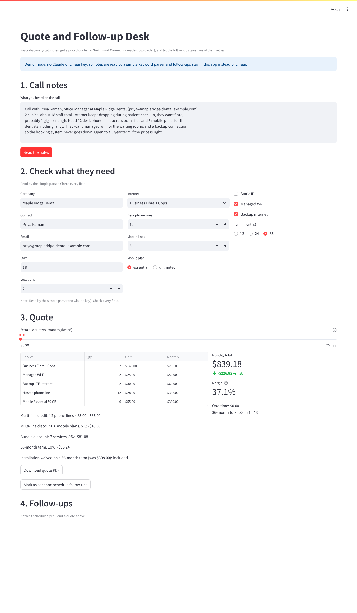

# Quote and Follow-up Desk (quoting and follow-up)

**[Live demo](https://smb-deal-bot-pb9vfrp4g6dybpmerysglx.streamlit.app/)** (demo mode: simple notes parser, follow-ups stay in the app instead of Linear)

**Problem:** after a good discovery call, a rep spends 30+ minutes building a quote by hand, guesses at how much discount is safe, then forgets to follow up. Quotes go cold.

**What it does:**
1. Paste rough call notes. Claude reads them into structured needs (company, sites, internet speed, phone and mobile lines, add-ons, term). The rep checks and edits every field before anything is priced.
2. Prices the deal from a price book with real-world rules: multi-line credits, a bundle discount for buying several service families, a term discount, and installation waived on 36-month terms.
3. Lets the rep add an extra discount, but caps it so the deal never drops below a **25% margin floor**, and says so when it does.
4. Produces a one-page PDF quote.
5. When the quote is sent, schedules follow-ups on day 2, 5 and 10. A daily Kubernetes CronJob turns each one into a **Linear task** with a due date when it comes due.
6. When the client replies, the remaining follow-ups stop and their Linear tasks are closed.

All prices and products belong to **Northwind Connect, a made-up provider**. Nothing here is real pricing.

Without API keys it runs in **demo mode**: a simple keyword parser reads the notes, and follow-ups stay inside the app instead of Linear.



## Pricing rules

| Rule | Value |
| --- | --- |
| Internet | 300 Mbps $95, 1 Gbps $145, 3 Gbps $220 per site per month |
| Hosted phone line | $28 per line, $3 credit per line at 10+ lines |
| Mobile | Essential $55, Unlimited $75; 5% off at 5+ lines, 10% at 10+ |
| Add-ons | Static IP $15, Managed Wi-Fi $25, Backup LTE $30 (per site) |
| Bundle | 4% off for 2 service families, 8% for 3 |
| Term | 12 months list, 24 months 5% off, 36 months 10% off and free install |
| Margin floor | 25%; extra discount is capped to stay above it |

The rules live in [`quote_desk/price_book.py`](quote_desk/price_book.py) and [`quote_desk/quote.py`](quote_desk/quote.py).

## Run it

On your laptop:

```bash
cd services/quote-desk
pip install -r requirements-dev.txt
python -m pytest -q tests
streamlit run quote_desk/app.py
```

Where quotes are saved: in the cluster, the chart's Postgres, so the app and the CronJob share the same data. With `DATABASE_URL` or `QUOTE_DESK_DATA` set, that database (or a SQLite file in that folder). With none of these, as on the public demo, each browser tab gets its own private in-memory database, so no visitor sees another's quotes. Set `QUOTE_DESK_DATA=.` on a laptop if you want the app and `quote_desk.cli` to share a file.

Each quote gets its number (Q-0001, Q-0002, ...) from the database when it is marked as sent; the PDF is offered after that, with the same number.

On the local Kubernetes cluster:

```bash
docker build -t smb-deal-bot/quote-desk:dev services/quote-desk
kind load docker-image smb-deal-bot/quote-desk:dev --name <your-cluster>
helm upgrade --install smb-deal-bot deploy/helm/smb-deal-bot -n smb-deal-bot \
  --set leadRadar.enabled=true --set quoteDesk.enabled=true
kubectl -n smb-deal-bot port-forward svc/quote-desk 8502:80
```

Then open http://localhost:8502. To run the follow-up job right now instead of waiting for the schedule:

```bash
kubectl -n smb-deal-bot create job --from=cronjob/quote-desk-followups followups-now
kubectl -n smb-deal-bot logs job/followups-now
```

### Public demo link (Streamlit Community Cloud)

Same as Lead Radar: create a second app from this repo with main file `services/quote-desk/streamlit_app.py`, Python 3.12, and **no** secrets.

## Turn on Claude and Linear

Uses the same `.env` keys as Lead Radar (`ANTHROPIC_API_KEY`, `LINEAR_API_KEY`, `LINEAR_TEAM_KEY`), with the same team rule: blank means the first team, and a team key or name matches in any case. In the cluster, `LINEAR_TEAM_KEY` comes from the Secret unless you set `quoteDesk.linearTeamKey`. From the command line:

```bash
python -m quote_desk.cli run-followups                    # what the CronJob runs
python -m quote_desk.cli run-followups --today 2026-12-01 # pretend it's a later date
```

## Honest limits

- The price book is invented. A real one would come from the provider's catalogue and change often.
- Replies are marked by hand. A next step is reading the inbox to notice replies automatically.
- The keyword parser in demo mode is rough on purpose; Claude does the real reading.
